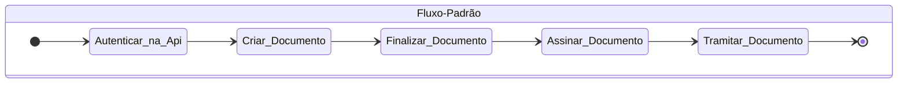

#  

# **Bem vindo a Api do Sigadoc MT**

<Tabs>
  <Tab title="Fluxo Padrão">
   

      
      

<Steps>
  <Step title="Autenticar na Api">
:::highlight green 
## 🔐
#### [Recebe login e senha e gera um token JWT para ser usado nos outros métodos da API](api-6389658) 
:::
  </Step>
  <Step title="Criar Documento">
    :::highlight green 
## 🆕
#### [Cria um novo documento](api-6389736)
:::
  </Step>
  <Step title="Finalizar Documento">
      :::highlight green 
## 👌
#### [Finalizar elaboração do documento e obter uma numeração final](api-6389709) 
:::
  </Step>
  <Step title="Assinar Documento">
    :::highlight green 
## ✍️
#### [Assinar documento com pin](api-6389702) 
##### Ou
#### [Assinar documento com PKCS7](api-6389701)
:::
  </Step>
  <Step title="Tramitar Documento">    
:::highlight green 
## 📤
#### [Tramitar documento para outro usuário ou lotação ou Órgão externo](api-6389711) 
:::
  </Step>
</Steps>
  </Tab>
  <Tab title="Dados Publicação Iomat">
    ✌️ Em construção
  </Tab>
</Tabs>
